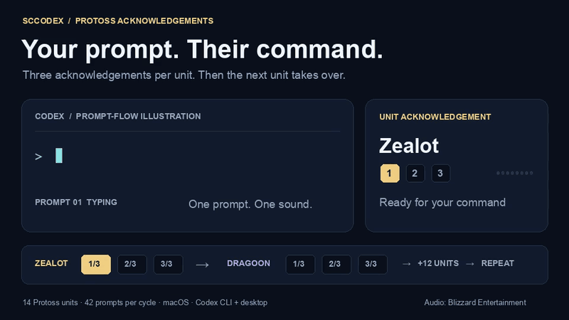

# SCCodex

**Give every Codex prompt a Protoss acknowledgement.**

Submit a prompt. A Zealot answers. Three prompts later, a Dragoon takes over.
SCCodex brings the classic StarCraft command sounds to the Codex you already use.

**macOS · Codex CLI + desktop · 14 units · 42-prompt loop**

[](docs/media/demo.mp4)

*The GIF is silent and illustrates the prompt flow; SCCodex itself plays audio
without adding a visual panel to Codex.*
**[Watch with sound — MP4](docs/media/demo.mp4)** · **[Try the soundboard](#hear-it-in-your-browser)**

## Your coding session, with a little more Aiur

- **One prompt, one acknowledgement.** Each unit gets three consecutive prompts,
  then the next unit takes over. After Arbiter, it's back to Zealot.
- **Keep your usual Codex.** Works through the official `UserPromptSubmit` hook.
  Use your existing account, models, CLI, or desktop app.
- **Ready when you are.** Rotation, mute, and volume persist between sessions.
  Sound plays in the background while Codex works.
- **Local playback.** Fetch the audio once; playback then works offline. The
  sound hook never records or forwards your prompt text.

## Get your first acknowledgement

You need **macOS**, an installed **Codex CLI with lifecycle hooks**, **Python
3.9+**, and **ffmpeg**. No Python packages or extra API key are needed.
With Homebrew, install missing prerequisites using `brew install python ffmpeg`.

```sh
git clone https://github.com/amicus-investments/sccodex.git
cd sccodex

./sccodex fetch            # Download, verify, and prepare the sound pack
./sccodex preview zealot   # Hear the three Zealot acknowledgements
./sccodex setup            # Install the prompt hook
codex
```

In the Codex CLI, open **`/hooks`**, review the command ending in
`sccodex/src/sccodex.py hook`, and **trust it once**. Then submit a prompt.
For the desktop app, start a new chat after setup and trust. See
[Codex's hook documentation](https://learn.chatgpt.com/docs/hooks).

After setup, ordinary `codex` launches use the sound hook. You can also use
`./sccodex` as a launcher; normal arguments pass through:

```sh
./sccodex resume
./sccodex exec "Explain this repository"
```

## Hear it in your browser

The repository includes a short video with real audio and a soundboard for all
14 units. To try the video before installing the hook, clone the repo and run:

```sh
python3 scripts/preview.py
```

Open **[localhost:8765/docs/](http://localhost:8765/docs/)**. Use the video controls
or click an acknowledgement to replay it. The soundboard uses downloaded WAVs
when available; otherwise it streams the original clips from the pinned source
mirror when you press play. It does not change your prompt rotation.
Stop the server with **Ctrl+C**.

GitHub READMEs display the GIF, but strip embedded HTML audio players. The
browser preview provides the playable clips. The
[MP4](docs/media/demo.mp4) can also be downloaded and played on its own.

## Meet the rotation

```text
Prompt 1   → Zealot 1/3
Prompt 2   → Zealot 2/3
Prompt 3   → Zealot 3/3
Prompt 4   → Dragoon 1/3
    …
Prompt 42  → Arbiter 3/3
Prompt 43  → Zealot 1/3
```

<details>
<summary>All 14 units, in order</summary>

| Prompts | Unit | Preview in your terminal |
| --- | --- | --- |
| 1–3 | Zealot | `./sccodex preview zealot` |
| 4–6 | Dragoon | `./sccodex preview dragoon` |
| 7–9 | High Templar | `./sccodex preview high-templar` |
| 10–12 | Dark Templar | `./sccodex preview dark-templar` |
| 13–15 | Archon | `./sccodex preview archon` |
| 16–18 | Dark Archon | `./sccodex preview dark-archon` |
| 19–21 | Probe | `./sccodex preview probe` |
| 22–24 | Shuttle | `./sccodex preview shuttle` |
| 25–27 | Reaver | `./sccodex preview reaver` |
| 28–30 | Observer | `./sccodex preview observer` |
| 31–33 | Scout | `./sccodex preview scout` |
| 34–36 | Corsair | `./sccodex preview corsair` |
| 37–39 | Carrier | `./sccodex preview carrier` |
| 40–42 | Arbiter | `./sccodex preview arbiter` |

The Observer has two acknowledgement clips; its third slot repeats its first.
That's 41 unique recordings across 42 slots.

</details>

## Make it yours

| Command | What it does |
| --- | --- |
| `./sccodex volume 50` | Set volume from 0–100; default is 65 |
| `./sccodex mute` | Pause sounds and the rotation |
| `./sccodex unmute` | Resume where you left off |
| `./sccodex reset` | Go back to Zealot 1/3 |
| `./sccodex status` | Show the next clip, settings, and any audio error |
| `./sccodex preview dark-templar` | Hear a unit's three clips without advancing |
| `./sccodex play` | Play the next clip and advance manually |
| `./sccodex list` | Show the full unit order |
| `./sccodex uninstall` | Remove the SCCodex hook |

`preview` is an explicit sound check and plays even if the prompt hook is muted.
Volume 0 silences previews too and pauses the prompt rotation. Uninstall
preserves your other hooks, downloaded sounds, and SCCodex settings.

<details>
<summary>Not hearing anything?</summary>

1. Run `./sccodex preview zealot`. If it reports missing audio, run
   `./sccodex fetch` and `./sccodex setup` again.
2. Run `./sccodex status`. Use `./sccodex unmute` and `./sccodex volume 65` if needed.
3. In Codex, check `/hooks` and trust the SCCodex command. Start a new session
   after changing hooks.
4. Check your Mac's output device and system volume. Playback errors appear in
   `./sccodex status` and do not reject a Codex prompt.

Want acknowledgements when Codex finishes instead? Run
`./sccodex setup --event finish`, review the hook, and start a new session.

</details>

## Build with us

Terran and Zerg packs, Linux/Windows playback, and native plugin packaging are
good next contributions. The current version is a local hook installer;
marketplace installation is not available yet.

Read [CONTRIBUTING.md](CONTRIBUTING.md) for development and validation, or
[how it works](docs/DEVELOPMENT.md) for the hook, state, and audio details.

## License and credits

SCCodex's code and original documentation are **[MIT licensed](LICENSE)**.
StarCraft audio and trademarks belong to **Blizzard Entertainment** and are
excluded from that license. The full sound pack is fetched separately and is
not committed to the repository. The short demo video contains Blizzard audio;
see [NOTICE.md](NOTICE.md) for attribution and applicable policies.

Audio source: [hometlt's StarCraft assets mirror](https://github.com/hometlt/starcraft-all-races-assets),
pinned and checksum-verified. SCCodex is an independent fan project, unaffiliated
with Blizzard Entertainment or OpenAI.
